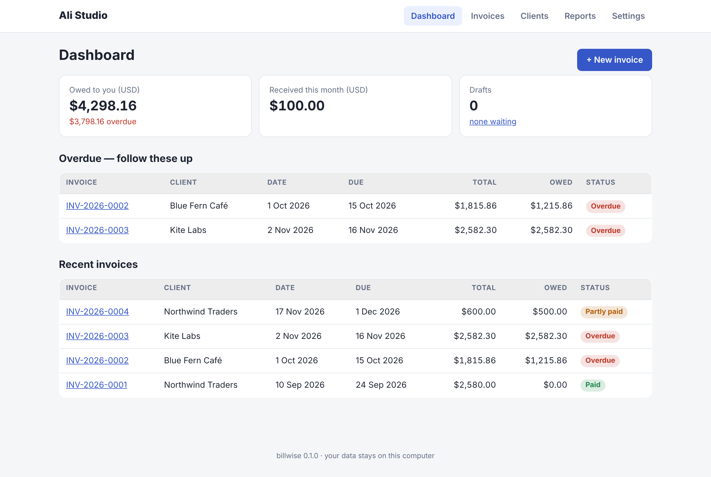
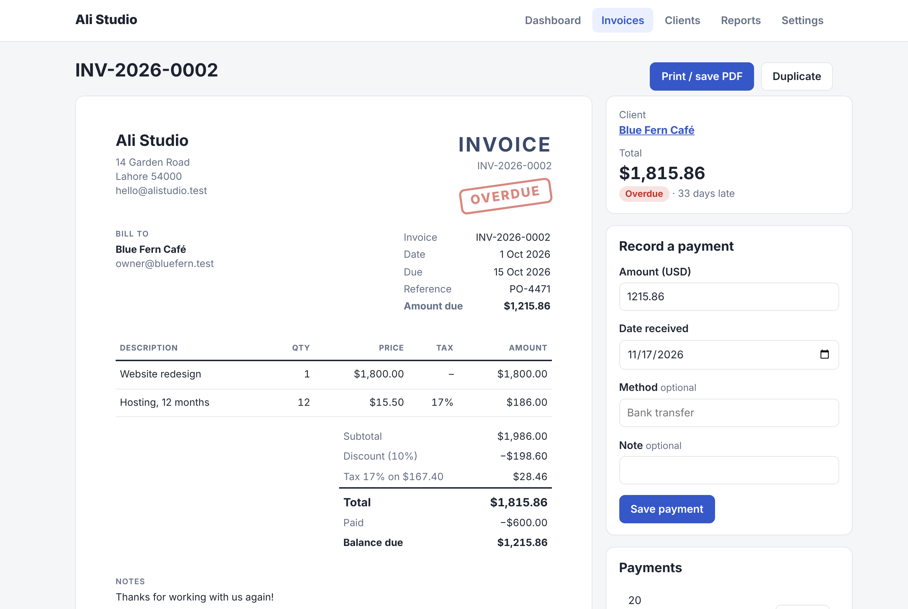
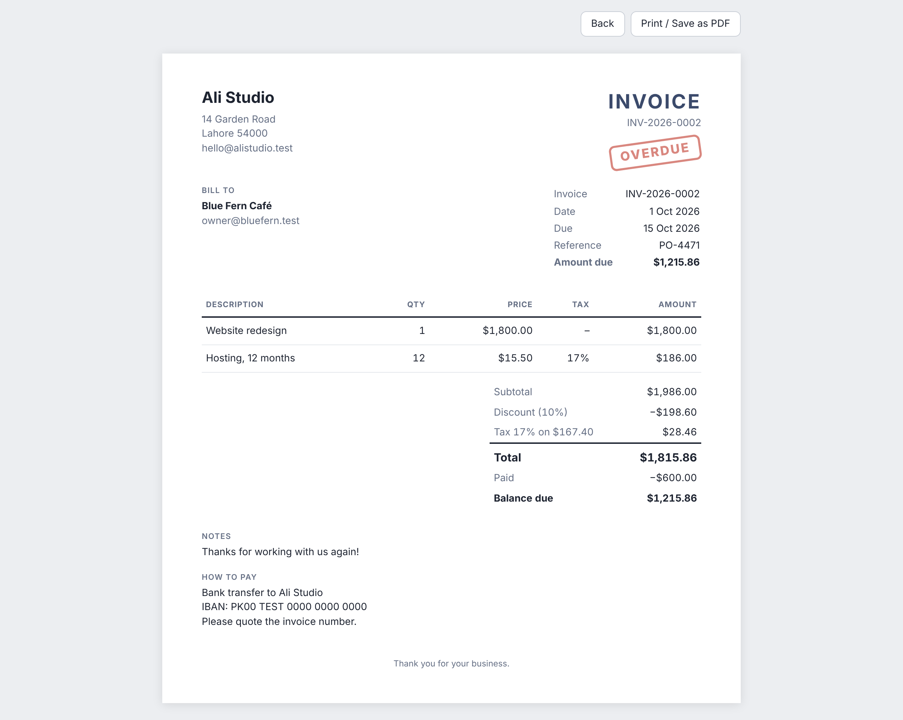
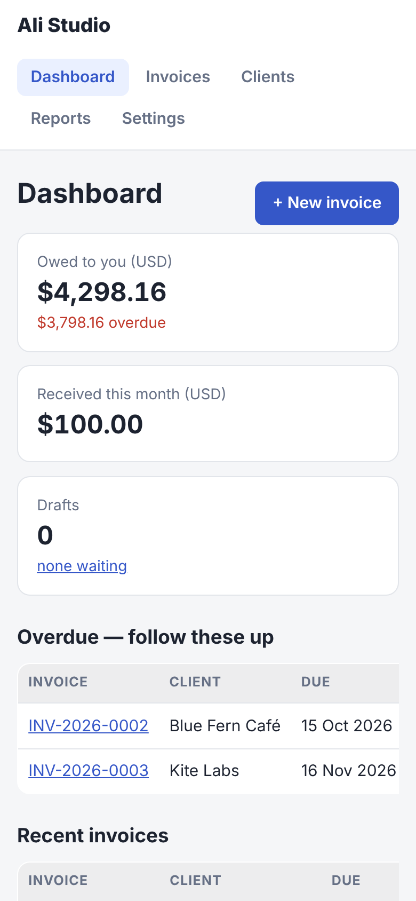
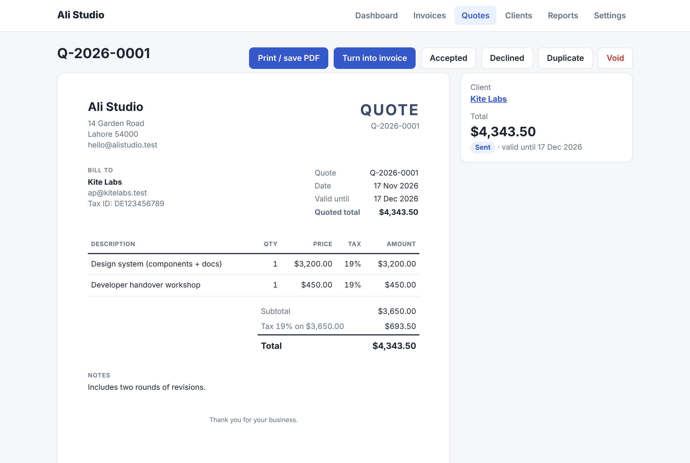
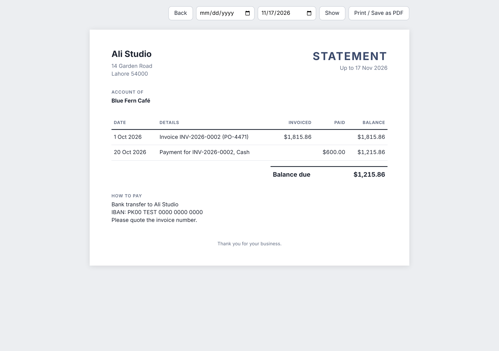

# billwise

**Invoices, clients and payments for freelancers and small businesses, kept on your own computer.**

billwise is a small invoicing app you run yourself. Make an invoice in a minute, print it or save it as a PDF, record payments as
they arrive, and see at a glance who owes you money and how late they are. There's no account, no subscription and no cloud:
everything is one file on your computer that you can back up.

It runs as a web app in your browser (served only to your own computer) and as a command-line tool for scripting.



## Why

Most small businesses start invoicing with a spreadsheet or a word-processor template, and it goes wrong the same ways:
numbers get skipped or reused, totals don't match the lines, tax is miscalculated after a discount, and nobody remembers who
hasn't paid. Online invoicing services fix that but cost a monthly fee and hold your financial records. billwise does the
bookkeeping-critical parts carefully and keeps the data with you.

## What it does

- **Clients**: names, addresses, emails and tax IDs. Clients with invoices can be archived but never deleted, so old invoices keep their client.
- **Invoices**: lines with quantity, price and tax rate, a percent or fixed discount, a reference (the client's PO number) and notes.
  - **Drafts** can be changed freely. **Issuing** gives the invoice its number and locks it, because what the client received must not change.
  - **Numbers have no gaps**: a number is only handed out when an invoice is issued, in order, restarting each year if the format has a year (`INV-2026-0001`). Many tax authorities require this.
  - **Void** cancels an issued invoice but keeps its number. **Duplicate** copies any invoice into a new draft for repeat work.
- **Correct money**: exact decimal arithmetic (never floating point), each line rounded once, the discount shared fairly between tax rates, and the printed tax lines always add up to the printed total. Currencies with no cents (JPY) or three decimals (KWD) are rounded correctly.
- **Quotes**: send a price before the work starts, with its own numbering (`Q-2026-0001`) and a "valid until" date. Mark it accepted or declined, and turn an accepted quote into an invoice in one click. Quotes never count as money owed, income or tax.
- **Payments**: record full or partial payments. The status follows automatically: *unpaid*, *partly paid*, *overdue*, *paid*. Overpaying by mistake is caught.
- **Printable invoice**: a clean A4/Letter page with your business details, "how to pay" instructions, and a PAID / OVERDUE / VOID stamp. Use your browser's "Save as PDF" to send it.
- **Client statements**: everything a client has been invoiced and has paid, with a running balance and the amount due, ready to print or send. Pick a period and earlier activity becomes the balance brought forward.
- **Reports**: money owed by how late it is (aging), invoiced and received per month, and tax charged per rate for a period (for your VAT/GST/sales-tax return). Every currency is kept separate.
- **Export and backup**: CSV of invoices and payments for your accountant or a spreadsheet (safe against spreadsheet formula injection), and a one-click backup of all your data.

| Invoice page | Printable invoice | On a phone |
|---|---|---|
|  |  |  |

| A sent quote | Client statement |
|---|---|
|  |  |

## Install

You need Python 3.10 or newer. billwise has **no dependencies** beyond the standard library.

```sh
git clone https://github.com/zeexduaa/billwise
cd billwise
python -m pip install .
```

## Use it in the browser

```sh
billwise serve
```

This opens http://127.0.0.1:8765/ in your browser. The dashboard walks you through the first three steps: your business
details, your first client, your first invoice. Press Ctrl+C in the terminal to stop.

## Use it from the terminal

```sh
billwise setup --business-name "Ali Studio" --currency USD --terms-days 14 \
               --payment-details "Bank transfer, IBAN PK00 0000 0000 0000"
billwise client add "Northwind Traders" --email accounts@northwind.test

# description | quantity | unit price | tax %   (quantity and tax are optional)
billwise invoice new northwind -l "Logo design | 1 | 1,200" -l "Hosting | 12 | 15.50 | 17" --discount 10% --issue
billwise invoice html INV-2026-0001          # a printable page; open it and "Save as PDF"
billwise pay INV-2026-0001 500 --method "Bank transfer"
billwise pay INV-2026-0001                   # pays whatever is still owed

billwise quote new northwind -l "Website redesign | 1 | 3,000" --send
billwise quote accept Q-2026-0001
billwise quote convert Q-2026-0001           # a draft invoice with the same lines

billwise client statement northwind --from 2026-01-01
billwise invoice list --status open
billwise report owed                         # who owes you, and how late
billwise report monthly --from 2026-01-01
billwise report tax --from 2026-07-01 --to 2026-09-30
billwise export invoices -o invoices.csv
billwise backup ~/billwise-backup.db
```

Run `billwise --help` or `billwise invoice --help` for everything.

## Where your data is

One SQLite file:

| System | Location |
|---|---|
| Windows | `%APPDATA%\billwise\billwise.db` |
| macOS | `~/Library/Application Support/billwise/billwise.db` |
| Linux | `~/.local/share/billwise/billwise.db` |

Set `BILLWISE_DB` or pass `--db FILE` to use another file (for example one per business).

## Security

The web app only listens on `127.0.0.1`, so other computers on your network can't reach it. On top of that:

- every form carries a secret token, so another website can't submit forms to it;
- requests with an unknown `Host` header are refused, which blocks DNS-rebinding attacks;
- everything you type is escaped before it's shown, and a strict Content Security Policy blocks inline scripts.

## Development

```sh
python -m pip install -e . pytest
python -m pytest
```

The code is in `src/billwise`:

| File | What it holds |
|---|---|
| `money.py` | parsing, rounding and formatting amounts |
| `model.py` | clients, invoices and the totals and status logic |
| `store.py` | the SQLite file, numbering and the rules for issuing, paying and voiding |
| `reports.py` | aging, monthly figures, tax and CSV |
| `render.py` | the printable invoice |
| `web.py` | the browser app |
| `cli.py` | the command-line tool |

See [ROADMAP.md](ROADMAP.md) for what's planned next.

## License

MIT
